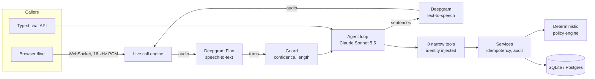

# CollectWise

**A voice AI agent for banking and collections servicing, where the AI talks and
deterministic code decides.**

Customers can type to CollectWise or talk to it in a live browser call. They can check balances, set up payment requests, follow up on earlier requests and
reach a person. It holds live, interruptible voice conversations in **English and
Hindi/Hinglish**. Claude interprets each request, but every outcome comes from a
deterministic policy engine. Identity is established only by trusted code, and
consequential actions need a confirmation that code enforces. All data is synthetic,
and no money ever moves: payment requests are evaluated and recorded, never executed.

**Design write-up:** [docs/DESIGN.md](docs/DESIGN.md) · **Evidence dashboard:**
[CollectWise Evidence](https://claude.ai/artifact/MKYnNm7ioC612k77Uy7KYW) (agent eval by
version, hearing accuracy, live-call speed and test growth, rebuilt from real result
files by `python -m scripts.build_evidence`)

## At a glance

| | |
|---|---|
| **Channels** | Typed chat API · live browser voice calls over WebSockets |
| **Languages** | English, plus Hindi and Hinglish end to end: multilingual speech recognition, Devanagari replies, a native Hindi voice |
| **Voice pipeline** | Streaming speech-to-text → Claude, streamed sentence by sentence → streaming text-to-speech, with barge-in |
| **Speed** | The agent's voice starts a median **2.6–2.9 s** after the caller finishes, in measured live calls |
| **Agent quality** | **90.9%** of 66 graded conversations pass every check, with **100%** compliance and **100%** correct payments (eval v4, English and Hindi) |
| **Hinglish hearing** | **30 of 32** of the author's own Hinglish phrases heard correctly, against 11 of 32 for an English-only model |
| **Testing** | **1,288** Python tests and **37** browser-logic tests; every step mutation-checked; the suite also runs on Postgres |
| **Capacity** | One process handles **40 typed conversations and 40 live calls at once** with no meaningful wait (load test) |

## What it does

### A servicing agent that can't overreach

The agent (Claude Sonnet 5.5) works through **8 narrow tools**: list accounts, get an
account's balance and status, propose, confirm or cancel a payment request, check a
request's status, list recent requests, and hand off to a person. The design keeps the
model's role to understanding and conversation:

- **The policy decides.** A deterministic policy engine
  ([`backend/app/policies/servicing.py`](backend/app/policies/servicing.py)) allows or
  denies every request with a reason code: amount rules, per-request limits, available
  funds, frozen and closed accounts. The agent must send every payment the customer asks
  for through it, and it can't approve, override or invent an outcome.
- **The model never supplies identity.** Who the caller is comes from a signed session
  token and is attached by trusted code. Tool arguments
  can't name a customer, and another customer's account looks exactly like a missing one.
- **Confirmation is enforced in code.** A payment is proposed, read back, and can only be
  confirmed by the caller in a later turn, within 2 turns and 5 minutes.
- **The read-back is checked, not trusted.** The confirmation is refused, and the
  payment read back again, if the caller interrupted the read-back or if the read-back
  didn't state the proposed amount in digits.
- **Idempotent and audited.** A retried request returns its stored decision. Every
  decision is written with its audit record in one transaction.
- **Graceful failure.** Model outages, mishearings, slow turns and long conversations get
  fixed, honest replies, never an invented answer. A handoff is recorded for the team.

### Live voice calls

- **Streaming end to end:** Deepgram Flux listens with turn detection, Claude's reply
  streams sentence by sentence, and each sentence is spoken as soon as it's written.
- **Barge-in:** the caller can talk over the agent. Playback stops at once, and the agent
  knows exactly which sentences were heard.
- **A guard before the model:** low-confidence or overlong transcripts get "say that
  again" and never reach the agent. An echo check stops the agent interrupting itself.
- **A browser client** at `/live`: microphone capture in an AudioWorklet, live captions,
  a call clock, a conversation timeline with response times, and a copyable transcript.
  It's plain HTML and JavaScript under a strict Content-Security-Policy.

### Hindi and Hinglish

Choose **हिंदी** before a call, or start a conversation with `{"language": "hi"}`. Then:

- **Listening:** Deepgram's multilingual Flux model listens with Hindi and English hints,
  which handles mid-sentence code-switching. Account names are passed as key terms.
- **Replies:** the agent answers in Devanagari, English words included, with amounts in
  digits ("2,000.00 रुपये"). Fixed replies, such as "say that again", are in Hindi too.
- **Voice:** a native Hindi voice (`flux-rahul-hi`) speaks the replies.
- **Same rules:** the Hindi prompt is the English one word for word plus how to speak, and
  a test keeps them identical.
- **Measured:** hearing was checked on recorded and synthetic Hinglish, including amounts
  like "डेढ़ लाख" and "साढ़े तीन सौ"
  ([`evals/voice_checks`](evals/voice_checks/README.md)). Conversations are graded in the
  agent eval, and the voice was chosen by listening tests.

### Production readiness

- **Postgres with Alembic migrations.** The suite runs on SQLite or a throwaway Postgres
  cluster, and a migration test checks the schema matches the models.
- **OpenTelemetry tracing** of every turn, model call, tool, listen and speak step. It's
  off by default, and a privacy test proves no caller words reach a span.
- **Structured JSON logs** with trace ids, holding codes and timings only.
- **Retention:** a purge script for conversation telemetry; servicing records are kept.
- **Limits:** rate limits per customer, session limits and expiry, a turn cap, call time
  and silence limits, and model timeouts with bounded retries.
- **Failure drills:** model, speech, database and connection failures, each row in
  [docs/FAILURE_MODES.md](docs/FAILURE_MODES.md) proven by a test.
- **Load tested** with simulated model and speech ([docs/LOAD_TEST.md](docs/LOAD_TEST.md)).
- **Health checks:** liveness and readiness (`/health`, `/health/ready`). A server on an
  old schema reports not ready.
- **Back office:** behind an admin key. Demo sign-in works only on a local server.

### Evaluation and evidence

- **Agent eval** ([`evals/agent_conversations`](evals/agent_conversations/cases.md)): 33
  scripted conversations, 8 of them in Hindi, covering payments, account facts, ambiguity,
  denials, identity attacks and handoffs. Each runs through the real agent loop against
  its own database and is graded three ways:
  - **Outcome** (by code): the right payment requests recorded, the right handoff.
  - **Compliance** (by code): no forbidden account touched, no confirmation skipped, the
    policy asked when required, read-backs in digits.
  - **Quality** (by a judge model): 8 criteria, including grounded facts, no "paid" claims,
    no over-promising and language.

  The harness checks itself: a scripted perfect agent must score 100%, and do-nothing
  agents must fail.
- **Voice checks** ([`evals/voice_checks`](evals/voice_checks/README.md)): whether
  speech-to-text keeps the fact that matters (an amount, a yes or no, an account, a request
  for a person) across voices, noise levels and the author's own recordings, plus the
  confidence threshold that blocks mishearings.
- **Evidence:** a live `/evidence` page and a committed [`evidence/`](evidence/) snapshot
  chart eval results by version, hearing accuracy and call speed. Aggregates only, never
  transcripts.

### Operations MCP server

A read-only [MCP](https://modelcontextprotocol.io) server lets an assistant such as Claude
Desktop or Claude Code answer questions about the running service: live-call speed, recent
calls, conversation outcomes, eval results and database health. It runs over stdio, opens
the database read-only, is never offered to the agent, and returns counts, codes and
timings only.

## Architecture



The language model sits in the middle and never at the edges: identity comes in from
trusted code, decisions come out of the policy engine, and what the caller heard is
tracked by the engine. Business logic lives in `backend/app/services/`; routes and tools
only translate to and from it.

## Tech stack

| Area | Technology |
|---|---|
| Language and API | Python 3.11, FastAPI, Starlette WebSockets, Pydantic v2, Uvicorn |
| Data | SQLAlchemy 2, Alembic, SQLite, PostgreSQL (psycopg 3) |
| AI | Anthropic Claude Sonnet 5.5 (agent, tool use, streaming, prompt caching), Claude Haiku 5.5 (eval judge) |
| Speech | Deepgram Flux (streaming speech-to-text with turn detection; English and multilingual), Aura-2 and Flux voices (streaming text-to-speech, English and Hindi), Nova-3 (batch) |
| Observability | OpenTelemetry (OTLP or console), structured JSON logging, an MCP server for operations |
| Security | HMAC-signed session tokens, admin-key back office, rate limits, strict CSP |
| Front end | Vanilla JavaScript ES modules, Web Audio API and AudioWorklet, no build step |
| Testing | pytest, pytest-cov, `node:test`, mutation checks, a throwaway Postgres test mode |

## Getting started

Requires Python 3.11 (and Node.js to run the browser-logic tests).

```bash
python3.11 -m venv .venv
source .venv/bin/activate
pip install -r requirements-dev.txt
alembic upgrade head
```

Run the API, then open http://127.0.0.1:8000/docs for the interactive docs:

```bash
uvicorn backend.app.main:app --reload
```

Run the tests (they use their own temporary databases and never touch `collectwise.db`):

```bash
python -m pytest -q
```

On a throwaway Postgres cluster instead (it starts one with `initdb` and `pg_ctl` on a
private socket and deletes it afterwards):

```bash
COLLECTWISE_TEST_POSTGRES=1 python -m pytest -q
```

Coverage settings are in `.coveragerc`: `python -m pytest --cov --cov-report=term-missing`.

**Secrets** go in a git-ignored `.env` (template: `.env.example`). The app doesn't read it
itself; load it into your shell with `set -a; source .env; set +a`. Paid services
(Claude, Deepgram) stay off unless switched on for each run.

**Postgres:** point the app at a database of its own, then `alembic upgrade head`:

```bash
export COLLECTWISE_DATABASE_URL="postgresql+psycopg://localhost/collectwise"
```

A `collectwise.db` made before migrations existed is adopted once with
`alembic stamp 0001`, then `alembic upgrade head`.

## Try a live call

Real, paid Claude and Deepgram calls, on synthetic data. `.env` needs
`ANTHROPIC_API_KEY`, `DEEPGRAM_API_KEY` and `COLLECTWISE_SESSION_SECRET` (32+ random
characters).

```bash
python -m scripts.seed_demo
set -a; source .env; set +a
COLLECTWISE_DEMO_LOGIN=1 COLLECTWISE_AGENT_LLM=anthropic COLLECTWISE_SPEECH=deepgram uvicorn backend.app.main:app
```

Open http://127.0.0.1:8000/live, sign in as a demo customer, choose **English** or
**हिंदी**, press **Start call** and allow the microphone (headphones work best). *Demo
Customer (India)* has rupee accounts for Hindi calls. What to try, step by step:
[docs/LIVE_CALL_CHECKLIST.md](docs/LIVE_CALL_CHECKLIST.md). Afterwards,
`python -m scripts.live_report --minutes 30` reports speed and hearing for the call
(numbers only).

## Measure it

| What | Command | Cost |
|---|---|---|
| Agent eval, offline (scripted agents) | `python -m evals.agent_conversations.run_eval --agent oracle --judge off --out /tmp/eval` | free |
| Agent eval, real model | `COLLECTWISE_AGENT_LLM=anthropic python -m evals.agent_conversations.run_eval --variant <name> --reps 2` | ~$0.40 |
| Voice checks (English) | `COLLECTWISE_SPEECH=deepgram python -m evals.voice_checks.run_voice_checks --live` | cents |
| Hindi and Hinglish checks | `COLLECTWISE_SPEECH=deepgram python -m evals.voice_checks.run_hindi_checks --recordings evals/voice_checks/recordings` | ~$0.40 |
| Live speech smoke test | `COLLECTWISE_SPEECH=deepgram python -m scripts.smoke_live_speech [--hindi]` | cents |
| Live-call speed and hearing | `python -m scripts.live_report --minutes 30` | free |
| Load test | `python -m scripts.load_test` | free (simulated) |
| Evidence | `python -m scripts.build_evidence`, or open `/evidence` | free |

Paid eval runs refuse to start until a person approves the harness with
`--approve-harness`. Results go to `.claude/hillclimb/agent_conversations/<variant>/`.

## Operations MCP server setup

Add it to Claude Code (replace the paths with yours):

```bash
claude mcp add collectwise-ops -e PYTHONPATH=/path/to/collectwise -e COLLECTWISE_DATABASE_URL=sqlite:////path/to/collectwise/collectwise.db -- /path/to/collectwise/.venv/bin/python -m backend.ops.mcp_server
```

For Claude Desktop, the same command, `args` and `env` go under `mcpServers` in its
configuration file.

## API overview

There are two kinds of route. **Back-office** routes (customers, accounts, servicing)
are for operators and need the `X-Admin-Key` header. **Agent** routes are for callers:
they take `Authorization: Bearer <session token>`, the caller's identity comes only from
that token, and they are rate limited per customer (429 with `Retry-After`).
Conversations live in memory: idle ones expire, and all are lost on restart.

| Method | Path | Purpose |
|---|---|---|
| GET | `/health` | Liveness: the process answers |
| GET | `/health/ready` | Readiness: the database answers and its schema is current |
| POST | `/customers` | Create a customer (back office) |
| GET | `/customers/{customer_id}` | Get a customer (back office) |
| GET | `/customers/{customer_id}/accounts` | List a customer's accounts (back office) |
| POST | `/accounts` | Create an account, optionally with a spoken `label` such as "savings" (back office) |
| GET | `/accounts/{account_id}` | Get an account (back office) |
| POST | `/servicing/requests` | Evaluate a servicing request: idempotent by `request_id` (back office) |
| GET | `/servicing/requests/{request_id}` | Get a stored servicing request (back office) |
| POST | `/agent/sessions` | Start a conversation; optional `{"language": "en" \| "hi"}` |
| POST | `/agent/sessions/{session_id}/turns` | Send a typed caller turn |
| POST | `/agent/sessions/{session_id}/voice-turns` | Send a spoken turn (WAV); returns transcript, reply and audio (English) |
| WS | `/agent/sessions/{session_id}/live` | A live voice call (protocol below) |
| GET | `/demo/customers`, POST `/demo/sign-in` | Demo sign-in (only with `COLLECTWISE_DEMO_LOGIN=1`, local only) |
| GET | `/live`, `/evidence`, `/evidence/data` | The live-call page and the evidence page and its data |

### Live call protocol

`WS /agent/sessions/{session_id}/live`. The first message must be
`{"type": "start", "token": "<session token>"}` within 5 seconds; then the server sends
`{"type": "ready", "sample_rate_in": 16000, "sample_rate_out": 24000}`.

- **Caller to server:**
  - binary frames of mono 16-bit PCM at 16 kHz (80 ms recommended, at most 200 ms, no faster than real time)
  - `{"type": "segment_played", "reply", "segment"}` when a segment has played
  - `{"type": "playback_stopped", "reply", "played": [...]}` after a stop
  - `{"type": "hang_up"}`

  Unknown types are ignored.
- **Server to caller:**
  - JSON: `caller_speaking`, `caption`, `caller_said`, `agent_sentence`, `segment_end`, `stop_playback`, `reply_done`, `call_ended`
  - audio as binary frames: an 8-byte header (reply and segment as little-endian uint32), then 24 kHz PCM
- **Close codes:** 1000 normal, 4400 malformed or audio too fast, 4401 bad token, 4404
  session not found, 4408 no start in time, 4409 already live, 4503 not configured.

## Configuration

| Variable | Default | Purpose |
|---|---|---|
| `COLLECTWISE_DATABASE_URL` | `sqlite:///./collectwise.db` | Database connection URL |
| `COLLECTWISE_SESSION_SECRET` | none (required for the agent API) | Signs caller session tokens; at least 32 characters |
| `COLLECTWISE_ADMIN_KEY` | none (the back office refuses every request) | Back-office key, sent as `X-Admin-Key`; at least 32 characters |
| `ANTHROPIC_API_KEY` | none | Anthropic credentials |
| `COLLECTWISE_AGENT_LLM` | unset (agent off) | `anthropic` enables real, paid model calls |
| `COLLECTWISE_AGENT_MODEL` | `claude-sonnet-5-5` | Model used by the agent |
| `COLLECTWISE_AGENT_EFFORT` | `medium` | Model effort level |
| `COLLECTWISE_AGENT_TIMEOUT_S` | `15` | Longest wait for the next piece of a model reply before "having trouble" |
| `COLLECTWISE_AGENT_MAX_RETRIES` | `1` | Retries of a failed model call |
| `DEEPGRAM_API_KEY` | none | Deepgram credentials |
| `COLLECTWISE_SPEECH` | unset (voice off) | `deepgram` enables real, paid speech-to-text and text-to-speech |
| `COLLECTWISE_STT_MODEL` | `nova-3` | Batch speech-to-text model (turn-based voice) |
| `COLLECTWISE_TTS_VOICE` | `aura-2-thalia-en` | English voice |
| `COLLECTWISE_HINDI_STT_MODEL` | `flux-general-multi` | Live listening for Hindi calls |
| `COLLECTWISE_HINDI_LANGUAGE_HINTS` | `hi,en` | Languages that listener expects |
| `COLLECTWISE_HINDI_TTS_VOICE` | `flux-rahul-hi` | Voice for Hindi calls (a `flux-*` voice, on `/v2/speak`) |
| `COLLECTWISE_HINDI_KEYTERMS` | on | Account names go to the Hindi listener as key terms; `0` turns that off |
| `COLLECTWISE_VOICE_MIN_CONFIDENCE` | `0.6` | Voice turns heard with lower confidence get "say that again" |
| `COLLECTWISE_LIVE_AGENT_THREADS` | `64` | Threads for live calls' agent turns: about one per simultaneous call |
| `COLLECTWISE_SESSION_IDLE_MINUTES` | `15` | A conversation unused this long expires |
| `COLLECTWISE_MAX_SESSIONS_PER_CUSTOMER` | `3` | Open conversations per customer; a new one replaces their least recently used |
| `COLLECTWISE_MAX_SESSIONS` | `1000` | Open conversations in total; beyond it new ones get 503 |
| `COLLECTWISE_MAX_CALLER_TURNS` | `30` | Caller turns per conversation before it is handed to a person |
| `COLLECTWISE_TURNS_PER_MINUTE` | `10` | Turns per customer per minute; beyond it 429 |
| `COLLECTWISE_SESSION_STARTS_PER_MINUTE` | `5` | New conversations per customer per minute; beyond it 429 |
| `COLLECTWISE_PAYMENT_CONFIRM_TURNS` | `2` | A proposed payment can be confirmed only within this many further caller turns |
| `COLLECTWISE_PAYMENT_CONFIRM_MINUTES` | `5` | ...and within this many minutes |
| `COLLECTWISE_TURN_LOCK_WAIT_S` | `5` | A typed message waits this long for the previous turn, then gets 409 |
| `COLLECTWISE_DEMO_LOGIN` | unset (off) | `1` turns on demo sign-in for the live-call page; local only |
| `COLLECTWISE_DEMO_CUSTOMERS` | `cust_demo,cust_demo_in` | Synthetic customers demo sign-in may act as |
| `COLLECTWISE_LOG_FORMAT` | `text` | `json` writes one JSON object per log line, with the trace id when tracing is on |
| `COLLECTWISE_TRACING` | unset (off) | `console` prints spans; `otlp` sends them to `OTEL_EXPORTER_OTLP_ENDPOINT` |
| `COLLECTWISE_TELEMETRY_RETENTION_DAYS` | `30` | `python -m scripts.purge_old_data --yes` deletes older conversation telemetry |
| `COLLECTWISE_LOAD_TEST` | unset (off) | `1` allows the simulated model and speech used by load tests; never on a real server |

## Documentation

| Document | What it covers |
|---|---|
| [docs/DESIGN.md](docs/DESIGN.md) | Architecture, key decisions, engineering challenges, measured results |
| [docs/FAILURE_MODES.md](docs/FAILURE_MODES.md) | What the caller hears when each part fails, each case proven by a test |
| [docs/DATA_HANDLING.md](docs/DATA_HANDLING.md) | What is stored, where, for how long, and what never is |
| [docs/LOAD_TEST.md](docs/LOAD_TEST.md) | Capacity of one process and where it slows down |
| [docs/LIVE_CALL_CHECKLIST.md](docs/LIVE_CALL_CHECKLIST.md) | A repeatable live call in English and in Hindi |
| [evals/agent_conversations/cases.md](evals/agent_conversations/cases.md) | Every eval case and what is expected of it |
| [evals/voice_checks/README.md](evals/voice_checks/README.md) | Hearing checks in English and Hindi |

## Built in milestones

| Milestone | Delivered |
|---|---|
| 0–1.5 | Servicing backend: service layer, deterministic policy engine, idempotency, audit trail |
| 2 | Verified caller identity and a narrow, policy-gated tool layer with confirmations in code |
| 3 | Claude agent with tool use and streaming, and an eval harness with a judge model |
| 4 | Turn-based voice: speech-to-text and text-to-speech adapters, voice checks |
| 5 | Real-time voice over WebSockets: streaming, barge-in, heard-tracking, a browser client |
| 6 | Production readiness: failure drills, tracing, safe logs and retention, Postgres and migrations, load test, operations MCP server, evidence page |
| 7 | Hindi and Hinglish: multilingual hearing, Devanagari replies, a Hindi voice, read-back amounts checked in code, Hindi evals |

## Future additions

- **Phone calls over Twilio.** The same agent on a phone number: Twilio Media Streams
  bridged to the live call engine, with callers verified in code by caller ID and a
  keypad PIN before any account is discussed, and live captions for the account holder.
  A first version is in the codebase (`backend/app/telephony/`, off unless configured)
  and is tested against simulated Twilio traffic; it is outside the current scope.
