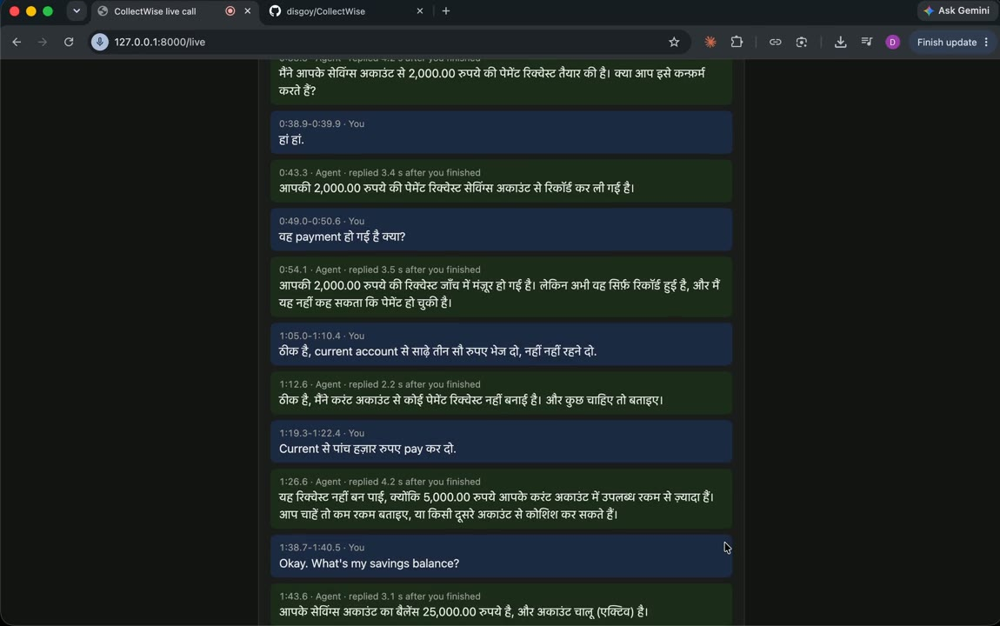
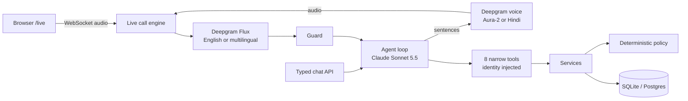

# CollectWise

**A bilingual voice AI agent for banking and collections: it speaks English and
Hindi/Hinglish, the AI talks, and deterministic code decides.**

Customers type or talk to CollectWise in a live browser call, in **English or Hindi**. They
can check balances, set up payment requests, follow up on earlier requests and reach a
person. Claude understands the request; a deterministic policy engine decides every outcome.
All data is synthetic, and no money moves: payment requests are evaluated and recorded,
never executed.

## Demo

[](https://github.com/user-attachments/assets/c2bb40ef-70db-4666-bad0-c935034825ca)

**[▶ Watch the 6-minute demo](https://github.com/user-attachments/assets/c2bb40ef-70db-4666-bad0-c935034825ca)**:
an English call and a Hindi call in the browser.

## At a glance

| | |
|---|---|
| **Bilingual** | English and Hindi/Hinglish end to end: multilingual speech recognition, Devanagari replies, a native Hindi voice |
| **Real-time voice** | Streaming speech-to-text → Claude → streaming text-to-speech, with barge-in |
| **Speed** | The agent starts speaking a median **2.6–2.9 s** after the caller finishes |
| **Quality** | **90.9%** of 66 graded conversations pass every check; **100%** compliance and correct payments |
| **Hinglish hearing** | **30/32** of a real speaker's phrases heard correctly (11/32 with an English-only model) |
| **Tested** | **1,288** Python + **37** browser tests, **96%** coverage, every step mutation-checked |
| **Capacity** | **40 typed + 40 live** conversations at once on one process |

## Bilingual by design

Start a call with **Start call in English** or **हिंदी में कॉल शुरू करें** (or `{"language": "hi"}` for typed chat). The
choice sets the whole conversation:

- **Hearing:** English calls use Deepgram Flux; Hindi calls use Flux's multilingual model
  with Hindi and English hints, so mid-sentence code-switching ("Savings से दो हज़ार रुपए
  pay कर दो") is understood.
- **Replies:** the agent answers in Devanagari, with amounts in digits ("2,000.00 रुपये").
  Fixed replies, such as "say that again", come in both languages.
- **Voice:** a native Hindi voice (`flux-rahul-hi`) for Hindi, Aura-2 for English.
- **Same rules in both languages:** the Hindi prompt contains the English one word for
  word, and the tools, policy and confirmations don't change.

The model and voice were chosen by measurement and listening tests, and Hindi conversations
are part of the agent eval.

## How it stays safe

- **The policy decides.** Every payment goes through a deterministic policy engine (limits,
  funds, account status) that allows or denies it with a reason. The model can't approve,
  override or invent an outcome.
- **The model never supplies identity.** Identity comes from a signed session token,
  through trusted code. Another customer's account looks exactly like a missing one.
- **Confirmed in code.** A payment is proposed, read back, and confirmed only in a later
  caller turn, within 2 turns and 5 minutes.
- **Read-backs are checked.** Confirmation is refused, and the payment read back again, if
  the caller interrupted the read-back or the read-back didn't state the amount in digits.
- **Audited and idempotent.** Every decision is stored with its audit record in one
  transaction; a retried request returns its original decision.

## Real-time voice

- **Fast:** Claude's reply is streamed and spoken sentence by sentence while the rest is
  still being written.
- **Barge-in:** the caller can interrupt at any time. Playback stops at once, and the agent
  knows exactly which sentences were heard.
- **Guarded:** misheard (low-confidence) or overlong speech gets "say that again" and never
  reaches the model.
- **Browser client** at `/live`: live captions, a call clock and a timeline with response
  times.

## Production readiness

- **Postgres with Alembic migrations;** the full test suite also runs on Postgres.
- **OpenTelemetry tracing and JSON logs,** holding codes and timings, never what callers
  said.
- **Limits:** rate limits, session limits, call time and silence limits, and model
  timeouts.
- **Failure drills:** every failure mode has a tested outcome
  ([FAILURE_MODES.md](docs/FAILURE_MODES.md)).
- **Load-tested capacity** ([LOAD_TEST.md](docs/LOAD_TEST.md)), and data retention
  ([DATA_HANDLING.md](docs/DATA_HANDLING.md)).

## Evaluation

- **Agent eval:** 33 scripted conversations, 8 in Hindi, run through the real agent loop and
  graded three ways: outcome and compliance by code, reply quality by a judge model. A
  scripted perfect agent must score 100%, so the grader is checked too.
- **Hearing checks:** English and Hinglish phrases across voices, noise levels and real
  recordings, scored on the fact that matters (an amount, a yes or no, an account).
- **Evidence page** at `/evidence`: eval results by version, hearing accuracy and call speed,
  from the real result files.

## Architecture



## Tech stack

| Area | Technology |
|---|---|
| Backend | Python 3.11, FastAPI, WebSockets, Pydantic v2, SQLAlchemy 2, Alembic, SQLite / PostgreSQL |
| AI | Claude Sonnet 5.5 (agent: tool use, streaming, prompt caching), Claude Haiku 5.5 (eval judge) |
| Speech | Deepgram Flux (streaming speech-to-text, English and multilingual), Aura-2 and Flux voices (English and Hindi) |
| Observability | OpenTelemetry, structured JSON logs |
| Front end | Vanilla JavaScript, Web Audio API, AudioWorklet |
| Testing | pytest, `node:test`, mutation checks, Postgres test mode |

## Getting started

```bash
python3.11 -m venv .venv && source .venv/bin/activate
pip install -r requirements-dev.txt
alembic upgrade head
python -m pytest -q
```

### Try a live call

Uses real (paid) Claude and Deepgram calls. Put `ANTHROPIC_API_KEY`, `DEEPGRAM_API_KEY` and
`COLLECTWISE_SESSION_SECRET` (32+ characters) in a `.env` file (see `.env.example`), then:

```bash
python -m scripts.seed_demo
set -a; source .env; set +a
COLLECTWISE_DEMO_LOGIN=1 COLLECTWISE_AGENT_LLM=anthropic COLLECTWISE_SPEECH=deepgram uvicorn backend.app.main:app
```

Open http://127.0.0.1:8000/live, sign in as a demo customer (*Demo Customer (India, rupees)* has
rupee accounts), and press **Start call in English** or **हिंदी में कॉल शुरू करें**. A step-by-step
script is in [LIVE_CALL_CHECKLIST.md](docs/LIVE_CALL_CHECKLIST.md).

### Measure it

| What | Command |
|---|---|
| Agent eval, free (scripted agents) | `python -m evals.agent_conversations.run_eval --agent oracle --judge off --out /tmp/eval` |
| Agent eval, real model (~$0.40) | `COLLECTWISE_AGENT_LLM=anthropic python -m evals.agent_conversations.run_eval --variant <name> --reps 2` |
| Hindi and Hinglish hearing | `COLLECTWISE_SPEECH=deepgram python -m evals.voice_checks.run_hindi_checks --recordings evals/voice_checks/recordings` |
| A call's speed and hearing | `python -m scripts.live_report --minutes 30` |
| Load test (free) | `python -m scripts.load_test` |

## API

Agent routes take `Authorization: Bearer <session token>`; back-office routes
(`/customers`, `/accounts`, `/servicing`) take `X-Admin-Key`. Full interactive docs are at
`/docs` when the server runs.

| Method | Path | Purpose |
|---|---|---|
| POST | `/agent/sessions` | Start a conversation; optional `{"language": "en" \| "hi"}` |
| POST | `/agent/sessions/{id}/turns` | Send a typed turn |
| WS | `/agent/sessions/{id}/live` | A live voice call: 16 kHz PCM in, captions and 24 kHz audio out |
| POST | `/servicing/requests` | Evaluate a servicing request (idempotent by `request_id`) |
| GET | `/health`, `/health/ready` | Liveness and readiness |

## Documentation

- [docs/DESIGN.md](docs/DESIGN.md): architecture, how a live turn works, and how the two languages work
- [docs/FAILURE_MODES.md](docs/FAILURE_MODES.md) · [docs/DATA_HANDLING.md](docs/DATA_HANDLING.md) · [docs/LOAD_TEST.md](docs/LOAD_TEST.md)
- [evals/agent_conversations/cases.md](evals/agent_conversations/cases.md): every eval case
- [evals/voice_checks/README.md](evals/voice_checks/README.md): hearing checks in English and Hindi

## Future additions

- **Phone calls over Twilio:** the same bilingual agent on a phone number, with callers
  verified by caller ID and a keypad PIN. A first version is in the codebase
  (`backend/app/telephony/`, off by default) and tested against simulated Twilio traffic.
