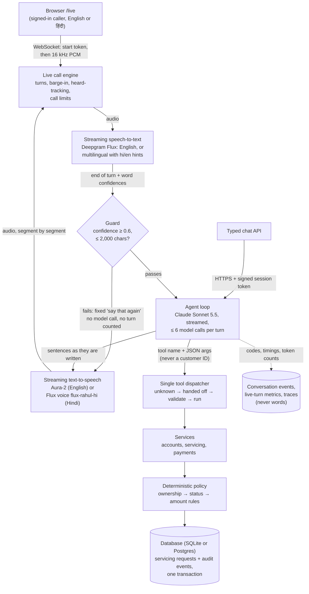

# CollectWise design

CollectWise started as a small, well-tested FastAPI/SQLAlchemy backend for customer
servicing: accounts, payment requests, a deterministic allow/deny policy, idempotent
requests and an atomic audit trail. It was extended one milestone at a time into a
**real-time voice AI servicing agent**:

1. A caller talks in a browser, in English or Hindi/Hinglish.
2. Deepgram's streaming speech recognition decides when they've finished.
3. Claude Sonnet 5.5 works out what they want and calls a narrow set of tools.
4. The same tested business logic decides the outcome.
5. The reply is spoken sentence by sentence while the rest is still being written, and
   the caller can interrupt at any point.

The model interprets requests; deterministic code decides. All data is synthetic, and
no money ever moves: a payment request is evaluated and recorded, never executed.

Decision numbers (D1–D122) refer to the project's decision log, which records each choice
with its date and reason.

## Architecture

Key places in the code:

| Area | Where |
|---|---|
| The policy | [`backend/app/policies/servicing.py`](../backend/app/policies/servicing.py) |
| The dispatcher and tool schemas | [`backend/app/tools/registry.py`](../backend/app/tools/registry.py) |
| The agent loop | [`backend/app/agent/loop.py`](../backend/app/agent/loop.py) |
| The languages | [`backend/app/agent/languages.py`](../backend/app/agent/languages.py) |
| The read-back amount check | [`backend/app/agent/readback.py`](../backend/app/agent/readback.py) |
| The live call engine | [`backend/app/voice/live_call.py`](../backend/app/voice/live_call.py) |
| The Deepgram streaming adapters | [`backend/app/voice/deepgram_live.py`](../backend/app/voice/deepgram_live.py) |
| The browser client | [`backend/app/static/live/`](../backend/app/static/live/) |

**Why the policy is authoritative and the model never supplies identity.** An LLM is
probabilistic and can be talked into things; a rule that decides money cannot be. So the
model's only power is to *ask*:
- **One way in:** it picks one of eight tools and fills in arguments. Every call goes
  through one dispatcher into the same services and policy the original REST API used,
  so a payment the agent proposes is judged by exactly the code the tests already cover
  (D2, D34).
- **Every payment is asked:** the agent must send every payment the customer asks for
  through `propose_payment` and let its result decide (D116).
- **Identity from trusted code only:** who the caller is comes from a signed session token
  checked by trusted code, which builds the `CallerContext`. No tool argument model has a
  `customer_id` field, and every one rejects unknown fields (D12, D13, D39).
- **The worst case:** a manipulated model can ask about an account that isn't the
  caller's, and the answer is "not found", the same as for an account that doesn't exist
  (D21).
- **Telemetry stays apart:** it is metadata only, and kept away from the financial audit
  trail (D3, D40).

**How a live turn works.** The engine (D81, D82):
1. **Streams the caller's audio** to Flux. Only a guarded end-of-turn transcript becomes a
   caller turn, never a partial.
2. **Starts the agent turn** on a dedicated thread pool.
3. **Speaks each sentence as soon as it is complete,** in segments it can track.
4. **Handles barge-in:** when the caller talks over the reply, playback stops at once, the
   unplayed audio is cleared, and the engine records exactly which sentences were heard.
   The model is told what the caller heard on their next turn. An echo check, comparing
   the caller's words with the agent's own recent words, stops the agent interrupting
   itself.
5. **Enforces call limits:** a 15-minute cap and a 2-minute silence limit, each ending
   with a spoken goodbye that is allowed to finish.

**Languages.** A conversation's language is chosen when it starts and fixed for it (D109):
- **What follows the language:** the system prompt, every fixed reply, the listener and
  the voice.
- **The Hindi prompt** is the English one word for word plus a short section on how to
  speak: Devanagari only, amounts in digits, speaking as a man. A test keeps the rules
  identical.
- **What doesn't change** with the language: the tools, the policy and the confirmation
  rules.
