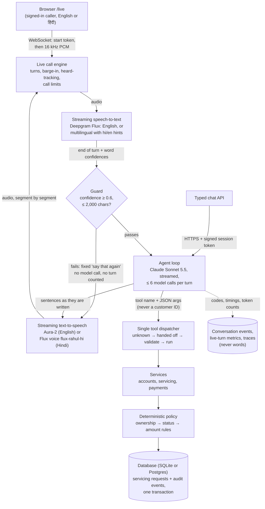

# CollectWise design

CollectWise started as a small, well-tested FastAPI/SQLAlchemy backend for customer
servicing: accounts, payment requests, a deterministic allow/deny policy, idempotent
requests and an atomic audit trail. It was extended one milestone at a time into a
**real-time voice AI servicing agent**:

1. A caller talks in a browser, in English or Hindi/Hinglish.
2. Deepgram's streaming speech recognition decides when they've finished.
3. Claude Sonnet 5.5 works out what they want and calls a narrow set of tools.
4. The same tested business logic decides the outcome.
5. The reply is spoken sentence by sentence while the rest is still being written, and
   the caller can interrupt at any point.

The model interprets requests; deterministic code decides. All data is synthetic, and
no money ever moves: a payment request is evaluated and recorded, never executed.

**Contents:** [Architecture](#architecture) · [Key decisions](#key-decisions) ·
[Engineering challenges](#engineering-challenges) · [Measured results](#measured-results) ·
[Testing approach](#testing-approach) · [Future additions](#future-additions)

Decision numbers (D1–D122) refer to the project's decision log, which records each choice
with its date and reason.

## Architecture

Key places in the code:

| Area | Where |
|---|---|
| The policy | [`backend/app/policies/servicing.py`](../backend/app/policies/servicing.py) |
| The dispatcher and tool schemas | [`backend/app/tools/registry.py`](../backend/app/tools/registry.py) |
| The agent loop | [`backend/app/agent/loop.py`](../backend/app/agent/loop.py) |
| The languages | [`backend/app/agent/languages.py`](../backend/app/agent/languages.py) |
| The read-back amount check | [`backend/app/agent/readback.py`](../backend/app/agent/readback.py) |
| The live call engine | [`backend/app/voice/live_call.py`](../backend/app/voice/live_call.py) |
| The Deepgram streaming adapters | [`backend/app/voice/deepgram_live.py`](../backend/app/voice/deepgram_live.py) |
| The browser client | [`backend/app/static/live/`](../backend/app/static/live/) |

**Why the policy is authoritative and the model never supplies identity.** An LLM is
probabilistic and can be talked into things; a rule that decides money cannot be. So the
model's only power is to *ask*:
- **One way in:** it picks one of eight tools and fills in arguments. Every call goes
  through one dispatcher into the same services and policy the original REST API used,
  so a payment the agent proposes is judged by exactly the code the tests already cover
  (D2, D34).
- **Every payment is asked:** the agent must send every payment the customer asks for
  through `propose_payment` and let its result decide (D116).
- **Identity from trusted code only:** who the caller is comes from a signed session token
  checked by trusted code, which builds the `CallerContext`. No tool argument model has a
  `customer_id` field, and every one rejects unknown fields (D12, D13, D39).
- **The worst case:** a manipulated model can ask about an account that isn't the
  caller's, and the answer is "not found", the same as for an account that doesn't exist
  (D21).
- **Telemetry stays apart:** it is metadata only, and kept away from the financial audit
  trail (D3, D40).

**How a live turn works.** The engine (D81, D82):
1. **Streams the caller's audio** to Flux. Only a guarded end-of-turn transcript becomes a
   caller turn, never a partial.
2. **Starts the agent turn** on a dedicated thread pool.
3. **Speaks each sentence as soon as it is complete,** in segments it can track.
4. **Handles barge-in:** when the caller talks over the reply, playback stops at once, the
   unplayed audio is cleared, and the engine records exactly which sentences were heard.
   The model is told what the caller heard on their next turn. An echo check, comparing
   the caller's words with the agent's own recent words, stops the agent interrupting
   itself.
5. **Enforces call limits:** a 15-minute cap and a 2-minute silence limit, each ending
   with a spoken goodbye that is allowed to finish.

**Languages.** A conversation's language is chosen when it starts and fixed for it (D109):
- **What follows the language:** the system prompt, every fixed reply, the listener and
  the voice.
- **The Hindi prompt** is the English one word for word plus a short section on how to
  speak: Devanagari only, amounts in digits, speaking as a man. A test keeps the rules
  identical.
- **What doesn't change** with the language: the tools, the policy and the confirmation
  rules.

## Key decisions

| # | Decision | Trade-off |
|---|---|---|
| **D23, D24** | **Propose → read back → confirm in a later turn.** Payments use three tools: `propose_payment(account, amount)`, `confirm_payment()` with no arguments, and `cancel_payment()`. Confirm is refused unless the caller has spoken since the proposal, and only the conversation manager can advance the turn counter. | Code can't judge whether "yes" meant yes, but it guarantees the caller had a turn after the read-back before anything is recorded, and the model has no way to confirm a different amount or account. Costs one extra exchange per payment. |
| **D82** | **An interrupted read-back can't be confirmed.** The engine knows which sentences were heard; if the caller talked over the read-back, confirming fails with `readback_not_heard` and the payment is read back again. | Barge-in is natural on a call, and a "yes yes" over a half-heard amount must not count. Costs a second read-back when a caller jumps in early. Shown working in live calls. |
| **D118** | **The read-back's amount is checked in code.** After `propose_payment`, the reply must state the proposed amount in digits (Latin or Devanagari, any grouping); otherwise confirming fails with `readback_missing`. | Hearing can be confidently wrong, and a model might write an amount in words or get it wrong, especially in another language. Digits-only is strict, but only digits can be checked exactly. The currency and account aren't checked. |
| **D12, D39** | **Identity only from signed tokens.** The caller's app is assumed to be signed in already; it presents an HMAC-SHA256 token (expiry, constant-time compare, signature checked before parsing). Request bodies never carry a customer ID. | No spoken passcodes or knowledge questions, which keeps voice simple and keeps identity out of the model's reach. Depends on the app's own sign-in. |
| **D34, D38** | **A hand-written agent loop and a single tool dispatcher**, rather than the SDK's tool runner. Every cross-cutting rule (no tools after a handoff, argument validation, no data echoed in errors) lives in `execute_tool`. History is append-only. | More code to own, but the runner would call tools directly and bypass those rules, and we need control of turn counting, call caps, streaming and telemetry. Switching LLM provider doesn't touch the tools. |
| **D61, D77** | **Own voice pipeline instead of a managed voice agent.** Deepgram does speech-to-text and text-to-speech around our own `run_turn`. | A managed agent handles turn-taking for you, but the conversation loop would run on the vendor's side: the confirm rules, call caps, fixed replies and the eval would no longer describe the production path. Also several times cheaper per minute. In return we own turn-taking and interruptions. |
| **D55, D65** | **Internal IDs taken out of what the model can say.** Request IDs were removed from every tool result. Accounts got speakable labels ("main", "savings"), and the prompt tells the model to use them. | The model can't read out what it never sees. Account IDs are still tool inputs, so for them it's a prompt rule, measured by the eval rather than enforced. |
| **D69** | **Speech-confidence threshold of 0.6, measured.** Transcripts below it get "say that again" with no model call. | No correctly heard clip scored below 0.75 while two mishearings scored 0.52 and 0.59. It can't catch *confident* mistakes, which is why the read-back stays the real safety net. Re-checked for the multilingual model: 0.6 blocks no correct Hinglish turn. |
| **D106, D107** | **Hindi through measurement, not assumption.** Before building, Hinglish hearing was measured on both Deepgram Flux models with synthetic voices and the author's own recordings. The multilingual model heard 30 of 32 of the author's phrases against 11 of 32, and was on par in English. | The measurement cost about $0.40 and showed English calls should keep the English-only model, which Deepgram also recommends for English. |
| **D108, D116** | **Hindi replies all in Devanagari, with amounts in digits,** in a voice chosen by ear (`flux-rahul-hi`). | The Hindi voice spells out anything in Latin letters ("T-E-A-M"), so English words are written as Hindi speakers write them (टीम, पेमेंट). Captions become all Devanagari, and digits keep the read-back checkable. |
| **D109** | **A language per conversation, fixed for the call**, rather than detected per turn. | Deterministic and testable: the voice and listener can't switch halfway through a sentence. Within Hindi the agent follows the caller's mix of Hindi and English words. |
| **D70** | **Back-office API behind an admin key.** The `/customers`, `/accounts` and `/servicing` routes require `X-Admin-Key`, attached per router and failing closed when unset; a route-inventory test fails on any unprotected route. | A shared key can't say which operator acted; per-person staff sign-in with roles is the production answer once staff exist. |
| **D72, D73** | **Conversation limits and payment expiry.** Idle conversations expire after 15 minutes; 3 open per customer; 30 caller turns, then a code-driven handoff; per-customer rate limits checked before any model, speech or upload work. A proposed payment expires after 2 further caller turns or 5 minutes. | In-memory and per process. Conversations are lost on restart by design: persisting them would mean storing what callers said. |
| **D74** | **Fixed-reply notes.** When the caller hears a canned reply the model never produced, or only part of an interrupted one, the next caller message carries a marked note saying so. | Keeps history append-only and roles alternating. A caller could type a fake note, but it carries no instructions. |
| **D93–D96** | **Production plumbing:** failure drills for every component, OpenTelemetry tracing, logs and stored telemetry that hold codes and timings but never words, a retention purge, and Postgres with Alembic migrations. | Tracing is off by default and privacy-tested; the whole suite runs on Postgres as well as SQLite. |
| **D97, D98** | **Load-tested before trusting it.** Simulated model and speech, timed like the real services, drive concurrent typed and live conversations through one process. | The test found two bottlenecks: a database connection held through model calls, and the default thread pool. With both fixed, one process takes 40 typed conversations and 40 live calls at once with no meaningful wait. |
| **D89, D99, D100** | **Evidence and operations without exposing words.** An evidence page and dashboard are built from the real result files, and a read-only MCP server answers operational questions, both returning aggregates, codes and timings only. | A reviewer or operator can see how the system performs; nothing a caller said leaves the process. The MCP server is never offered to the agent. |

## Engineering challenges

| Challenge | What happened | How it was solved |
|---|---|---|
| A voice whose "done" came early | Rahul's voice service sends "Flushed" *before* the last audio of a reply, unlike Aura; a paid smoke check showed the speaker dropping the end of every reply. | A reply now ends on the voice's "SpeechMetadata" for that exact speech id, the end-of-audio signal Deepgram's docs name (D111, D112). It was caught before any real Hindi call. |
| An interruption with nothing to stop | That voice sends no confirmation when interrupted while idle, so waiting for one could silence the next reply. | Audio is discarded only when a reply was still being generated, with a 2-second backstop, and a second interruption keeps the first one's discarding (D112). |
| Voices spelling out English | Rahul read English words written in Latin letters inside Hindi text letter by letter. | Hindi replies are written entirely in Devanagari, and a test keeps every Hindi fixed reply free of Latin letters (D116). |
| A refusal without the policy | In a live call the model refused "डेढ़ लाख" itself, from balances it already knew. Nothing is recorded for a refusal, so the eval couldn't see it. | A prompt rule (every payment through `propose_payment`), plus an eval check that the required tool was called. In the next eval run, every Hindi over-limit case asked the policy (D115, D116, D119). |
| Scoring Hindi hearing | Transcripts mix scripts, and amounts arrive as words ("डेढ़ लाख", "साढ़े तीन सौ", "do hazaar"). | A small reader for Hindi number words and digits in either script, used for scoring only; unknown words count as misheard rather than guessed (D106). |
| Load bottlenecks | Under load, turns queued behind a database connection held during model calls, and behind the default thread pool. | The connection is released after each tool, and live turns get a pool of their own (D98). |
| Last words cut off | A call ended by the agent closed before its final sentence finished playing. | The engine waits for the reply to finish playing before closing (D92). |
| Flaky concurrency test | The race-condition test failed about 1 run in 6. In-memory SQLite's single-connection pool isn't safe when several threads start the app at once. | Tests use a temporary file database; a deterministic test covers the race branch (D28). |
| Mutation runs lying | Mutation checks twice reported "0 failing" for a real bug: stale bytecode was being read. | Every mutation run gets a fresh bytecode cache and pytest's cache disabled; surprising results are re-run alone. |
| Can the eval be trusted? | A do-nothing agent scored 64% on the first headline metric, and the judge failed the perfect agent on 2 cases. | Every grading change is checked against an oracle that must score 100% and constant agents that must fail; the headline became `all_pass` (D50, D52). |
| Confident mishearings | "One hundred twenty five dollars and fifty cents" was heard as $135.50 at confidence 1.00. | No threshold can catch these, so the read-back before confirmation is enforced in code (D69, D82, D118). |
| The model reading out IDs | The baseline eval read a 32-character request ID aloud in 10 of 50 conversations. | Request IDs were removed from every tool result instead of adding a prompt rule (D55). |
| Deepgram SDK traps | The SDK retried with `Retry-After` for up to 60 s, and text-to-speech errors surfaced outside the error handling. | SDK retries off with short timeouts, and audio is consumed inside the error handling (D66). |
| A log leak found by a test | A privacy test found that Python's logging cached a formatted traceback, so a safe formatter running after another handler printed database values. | A formatter that rebuilds exceptions as type chains, with the privacy test kept as a guard (D95). |

## Measured results

All model and speech numbers come from paid runs started deliberately; nothing paid runs in
the test suite. The same numbers appear in charts on the
[evidence dashboard](https://claude.ai/artifact/MKYnNm7ioC612k77Uy7KYW) and the live
`/evidence` page, built from the result files (counts, rates and timings only).

**Agent eval** (synthetic conversations × 2 repetitions, Claude Sonnet 5.5, graded by code
checks plus a Claude Haiku 5.5 judge on 8 criteria):

| Version | Cases | all_pass | Change |
|---|---|---|---|
| Baseline | 25 | **70%** (35/50) | — |
| v1 | 25 | **96%** (48/50) | Request IDs removed from tool results; prompt rules for named accounts and handoff wording |
| v2 | 25 | **98%** (49/50) | Speakable account labels |
| v3 | 25 | **94%** (47/50) | Payment expiry, fixed-reply notes, interruption notes (and a speed experiment, since reverted) |
| v4 | 33 | **90.9%** (60/66) | 8 Hindi conversations added; every payment through the policy; read-backs in digits, checked in code; Devanagari replies |

- **v4 in detail:** compliance **100%**, correct payments **100%**, outcome 98.5%;
  English 46/50 and Hindi 14/16, for $0.37.
- **Read-backs:** every payment read-back stated its amount in digits, so the code check
  never had to intervene.
- **The policy was asked:** every Hindi over-limit request went through it.
- **What remains:** mostly strict judge calls on wording, kept as failures rather than
  loosening the rubric (D56).

**Hearing** (phrases scored on meaning: the amount, a yes or no, an account name or a request
for a person must survive):

| Test | Result |
|---|---|
| English, synthetic voices (3 accents, 8 kHz, clean and noisy) | **171/180** |
| English, the author's own voice | **27/30**, later 28/30 through the live model |
| Hinglish, synthetic Hindi voices (live, 16 kHz, clean and 10 dB) | **63/64** with the multilingual model |
| Hinglish, the author's own voice | **30/32** with the multilingual model (11/32 with the English-only model) |

**Speed:**
- **Milestone 4, turn-based voice: 5.8–9.5 s per turn.** Text-to-speech produced its first
  audio in about 0.33 s, but the whole reply took 2.7–6.6 s, which made streaming the main
  target.
- **Milestone 5, live streaming calls: the agent's voice starts a median 2.9 s after the
  caller finishes** (turns without a lookup about 2.0 s). The speech service's own
  end-of-turn detection, 0.5–1.2 s, comes on top.
- **Live Hindi call: median 2.6 s.** The Hindi voice's first audio arrives about 0.35 s after
  its text.

**Capacity:** one process, 40 typed conversations and 40 live calls at once with no
meaningful wait (load test with simulated model and speech, [LOAD_TEST.md](LOAD_TEST.md)).

**Code quality:**
- **1,288 Python tests and 37 browser-logic tests,** all passing in about 40 seconds.
- **96% line and branch coverage,** with no enforced threshold.
- **More than 550 deliberate bugs** were planted across the milestones to prove the tests
  catch them; each survivor got a test or was shown to be redundant.

## Testing approach

- **Privacy checked end to end.** A marker placed in the caller's words, tool data and the
  model's reply must appear in no trace span and no log line, even with the SDK's own
  content-recording and debug switches on. [DATA_HANDLING.md](DATA_HANDLING.md) lists
  every store and what it never holds.
- **Failure drills.** Each way a call can break has a test checking what the caller hears,
  what is recorded and what is left behind:
  - the model hanging or failing mid-turn
  - speech services dropping or stalling
  - a database error
  - the caller leaving mid-turn or mid-payment

  [FAILURE_MODES.md](FAILURE_MODES.md) lists them all, and a test fails if the table names
  a test that doesn't exist.
- **A fake for every paid service, shaped by measurement.** `FakeLLM`, the fake listeners
  and the fake voices script responses and failures. The real adapters are tested against
  fakes built from the installed SDK and from what paid smoke checks observed; for
  example, the fake Hindi voice answers in the exact message order the real one used.
  Paid services stay off unless switched on explicitly, and the test configuration
  removes those switches, so the suite can never spend money.
- **Vendor behaviour checked before code relies on it.** Short paid smoke scripts
  (`smoke_live_speech`, with `--hindi`) ask the streaming sockets what their docs don't
  say, and the adapters are built on the answers.
- **Mutation testing, by hand.** After each step, deliberate bugs are put into the new
  code to prove the new tests fail. Every run gets a fresh bytecode cache, each mutant must
  change behaviour, and surprising results are re-run on their own.
- **Precise claims.** Each step records what its tests do and don't prove.
- **An eval harness with a fingerprint gate.**
  [`evals/agent_conversations/`](../evals/agent_conversations/) drives the production
  agent loop and prompts, in each case's language, against one database per case.
  - **Compliance by code:** forbidden accounts, early confirmation, read-backs without
    digits, and tools a case requires.
  - **A judge** grades wording, grounding, language and promises.
  - **A fingerprint gate:** the harness's files are hashed, and a paid run is refused until
    a person approves the current hash, so a changed grader can't silently produce numbers
    that look comparable with older runs.
- **Hearing checks** in [`evals/voice_checks/`](../evals/voice_checks/) score meaning
  rather than wording in English and Hindi. Each threshold gets a table of correct turns
  it would block against mishearings it would let through.
- **Real calls** follow [LIVE_CALL_CHECKLIST.md](LIVE_CALL_CHECKLIST.md), in English and
  in Hindi, and are measured with `live_report`.

## Future additions

- **Phone calls over Twilio.** The same agent on a phone number: Twilio Media Streams
  bridged to the live call engine at 8 kHz μ-law with no conversion, Twilio's playback marks
  driving the same heard-tracking, and callers verified in code by caller ID and a keypad PIN
  before any account is discussed. A first version is in the codebase
  (`backend/app/telephony/`, off unless configured) and is tested against simulated Twilio
  traffic; it is outside the current scope.
