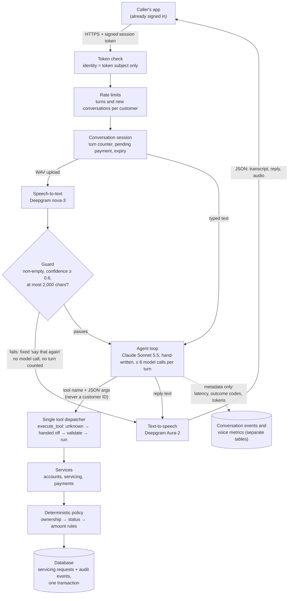

# CollectWise design

CollectWise started as a small, well-tested FastAPI/SQLAlchemy backend for customer servicing: accounts, payment requests, a deterministic allow/deny policy, idempotent requests and an atomic audit trail. It has been extended one milestone at a time into a **voice AI servicing agent**: a caller speaks, Deepgram turns the audio into text, Claude Sonnet 5.5 works out what they want and calls a narrow set of tools, the same tested business logic decides the outcome, and Deepgram speaks the reply. The model interprets requests; deterministic code decides. All data is synthetic, and no money ever moves: a payment request is evaluated and recorded, never executed.

**Contents:** [Architecture](#architecture) · [Key decisions](#key-decisions) · [Engineering challenges](#engineering-challenges) · [Measured results](#measured-results) · [Testing approach](#testing-approach) · [Roadmap](#roadmap)

Decision numbers (D1–D78) refer to the project's decision log, which records each choice with its date and reason.

## Architecture

Key places in the code: the policy is [`backend/app/policies/servicing.py`](../backend/app/policies/servicing.py), the dispatcher and tool schemas are [`backend/app/tools/registry.py`](../backend/app/tools/registry.py), the agent loop is [`backend/app/agent/loop.py`](../backend/app/agent/loop.py), the voice turn is [`backend/app/voice/turn.py`](../backend/app/voice/turn.py) and token signing is [`backend/app/auth/session_tokens.py`](../backend/app/auth/session_tokens.py).

**Why the policy is authoritative and the model never supplies identity.** An LLM is probabilistic and can be talked into things; a rule that decides money cannot be. So the model's only power is to *ask*: it picks one of eight tools and fills in arguments, and every call goes through one dispatcher into the same services and policy that the original REST API used, so a payment the agent proposes is judged by exactly the code the tests already cover (D2, D34). Who the caller is comes only from a signed session token checked by trusted code, which builds the `CallerContext`; no tool argument model has a `customer_id` field, and every one rejects unknown fields (D12, D13, D39). The worst a manipulated model can do is ask about an account that isn't the caller's, and the answer is "not found", the same as for an account that doesn't exist (D21). Operational telemetry is metadata only and is kept apart from the financial audit trail (D3, D40).

## Key decisions

| # | Decision | Trade-off |
|---|---|---|
| **D23, D24** | **Propose → read back → confirm in a later turn.** Payments are three tools: `propose_payment(account, amount)`, `confirm_payment()` with no arguments, `cancel_payment()`. Confirm is refused unless the caller has spoken since the proposal, and only the conversation manager can advance the turn counter. | Code can't judge whether "yes" meant yes, but it guarantees the caller heard the read-back before anything is recorded, and the model has no way to confirm a different amount or account. Costs one extra exchange per payment. |
| **D12, D39** | **Identity only from signed tokens.** The caller's app is assumed to be signed in already; it presents an HMAC-SHA256 token (expiry, constant-time compare, signature checked before parsing). Request bodies never carry a customer ID. | No spoken passcodes or knowledge questions, which keeps voice simple and keeps identity out of the model's reach. Depends on the app's own sign-in; telephony (M7) will need its own caller verification. |
| **D34, D38** | **A hand-written agent loop and a single tool dispatcher**, rather than the SDK's tool runner. Every cross-cutting rule (no tools after a handoff, argument validation, no data echoed in errors) lives in `execute_tool`. History is append-only. | More code to own, but the runner would call tools directly and bypass those rules, and we need control of turn counting, call caps and telemetry. Switching LLM provider doesn't touch the tools. |
| **D55, D65** | **Internal IDs taken out of what the model can say.** Request IDs were removed from every tool result. Accounts got speakable labels ("main", "savings"), and the prompt tells the model to use them. | Request IDs could be hidden in code, so they were: the model can't read out what it never sees. Account IDs are still tool inputs, so for them it's a prompt rule, measured by the eval rather than enforced; making tools take labels would add a lookup and new failure modes. |
| **D61, D77** | **Own voice pipeline instead of Deepgram's managed Voice Agent.** Deepgram does speech-to-text and text-to-speech around our own `run_turn`. | Voice Agent handles turn-taking for you, but the conversation loop would run on Deepgram's side: the confirm rule, call caps, fixed replies and the eval would no longer describe the production path. Also cheaper (about $0.008/min vs $0.065/min, plus text-to-speech characters either way). We own turn-taking and interruptions in M5. |
| **D69** | **Speech-confidence threshold of 0.6, measured.** Transcripts below it get "say that again" with no model call. | Across ~200 clips no correctly heard clip scored below 0.75, while two mishearings scored 0.52 and 0.59, so 0.6 blocks both at no cost. A small sample, and it can't catch *confident* mistakes, which is why the read-back stays the real safety net. |
| **D70** | **Back-office API behind an admin key.** The original `/customers`, `/accounts`, `/servicing` routes (found unauthenticated in a code review) require `X-Admin-Key`, attached per router, failing closed when unset; a route-inventory test fails on any unprotected route. | A shared key can't say which operator acted; per-person staff sign-in with roles is the production answer once staff exist. It closed a demonstrated hole now and is swappable in one function. |
| **D72** | **Conversation limits.** Idle conversations expire after 15 minutes; 3 open per customer (a new one replaces the oldest); 30 caller turns, then a code-driven handoff; 10 turns and 5 new conversations per customer per minute (429 with `Retry-After`), checked before any model, speech or upload work. | In-memory and per process, so several servers would need a shared store (M6). Conversations are lost on restart by design: persisting them would mean storing conversation content, and nothing is recorded until confirm. |
| **D73** | **Proposed payments expire** after 2 further caller turns or 5 minutes, whichever comes first; the model must propose (and read back) again. | Catches a "yes" that was about something else, and a stale screen. Costs one extra "yes" when a caller is slow, but they always confirm what they just heard. |
| **D74** | **Fixed-reply notes.** When the caller hears a canned reply the model never produced ("say that again", "try again"), the next caller message carries a marked note saying so. | Keeps history append-only and roles alternating (an assistant-role insert would break both). A caller could type a fake note, but it carries no instructions, so the worst case is a confused reply. |

## Engineering challenges

| Challenge | What happened | How it was solved |
|---|---|---|
| Flaky concurrency test | The race-condition test failed about 1 run in 6 with `Cannot operate on a closed database`. In-memory SQLite uses a single-connection pool that isn't safe when several threads run app startup at once. | Tests use a temporary file database; 60/60 full-suite runs passed afterwards, and a deterministic test covers the race branch (D28). |
| Mutation runs lying | Mutation checks twice reported "0 failing" for a real bug. `PYTHONDONTWRITEBYTECODE` stops writing `.pyc` files but not reading stale ones. | Every mutation run gets a fresh bytecode cache (`PYTHONPYCACHEPREFIX=<new dir>`) and pytest's cache disabled; surprising results are re-run alone. |
| Can the eval be trusted? | A do-nothing agent ("OK." to everything) scored 64% on the first headline metric, and the judge failed the scripted perfect agent on 2 cases by misreading case notes. | Every grading change is checked against an oracle that must score 100% and three constant agents (null, "I don't know", wrong) that must score 0%; added a `responsive` criterion; the headline became `all_pass` (outcome and compliance and quality) (D50, D52). |
| Judge too literal about money | The judge failed a correct read-back of "120 USD" against a note that said "120.00 USD". | Amounts are compared by value, not formatting, which also matters for speech (D53). |
| Real recordings rejected | All 15 of the author's own recordings were refused: macOS `afconvert` writes the "extensible" WAV header, which Python 3.11's `wave` won't read, though the audio is plain PCM. | Accept the extensible header only when its sub-format is plain PCM, by relabelling it before parsing; anything else is still refused (D68). |
| A crash found by a mutant | A mutation that removed one validation check didn't just fail a test: it exposed that a 0 Hz WAV header would divide by zero. | `read_wav` keeps its own sample-rate check, now pinned by a test. |
| Deepgram retry trap | The SDK honours `Retry-After` for up to 60 s between retries, far too long for a caller on the line. | SDK retries off, 10 s timeout; a transient failure goes straight to a polite fixed reply (D66). |
| Deepgram lazy stream trap | Text-to-speech returns a lazy stream, so errors surfaced while reading the audio, outside the error handling. | The audio is consumed inside the error handling, and the adapter is tested against fakes shaped like the SDK (D66). |
| Confident mishearings | One synthetic voice's "one hundred twenty five dollars and fifty cents" was heard as $135.50 at confidence 1.00 in all four noise conditions; a real voice lost the number in "a hundred and twenty", also at 1.00. | No threshold can catch these. The read-back before confirm is the protection, so it was kept code-enforced rather than prompt-enforced (D69). |
| The model reading out IDs | The baseline eval read the 32-character request ID aloud in every conversation that recorded a payment (10/50). | Removed request IDs from every tool result instead of adding a prompt rule (D55). |
| Uploads buffered before checks | FastAPI would read a whole upload into memory before any size check ran. | The voice endpoint is async only to read the body with a 3 MB cap (declared size rejected unread; streamed body stopped as soon as it passes the cap), then runs the synchronous turn on a worker thread (D64). |
| Streaming fallback leftovers | With streaming, a reply that falls back to another model keeps the declined attempt's partial content, including a tool call that must never run. | Declined thinking and tool blocks before the fallback marker are stripped before the loop sees the message (D78). |
| A route hidden from the schema | A mutant that hid an unprotected route from the OpenAPI schema survived the route-inventory test, which reads the schema. | Added a test that no route is hidden from the schema, closing the gap (D70). |

## Measured results

All model and speech numbers come from paid runs the author started deliberately; nothing paid runs in the test suite. The same numbers, in charts: the [evidence dashboard](https://claude.ai/artifact/MKYnNm7ioC612k77Uy7KYW), built by [`scripts/build_evidence.py`](../scripts/build_evidence.py) from the result files (counts, rates and timings only).

**Agent eval** (25 synthetic conversations × 2 repetitions, Claude Sonnet 5.5, graded by checks plus a Claude Haiku 5.5 judge; about $0.25 per run):

| Version | all_pass | Change |
|---|---|---|
| Baseline | **70%** (35/50, 95% CI 56–81) | — |
| v1 | **96%** (48/50, CI 87–99) | Request IDs removed from tool results; prompt rules for named accounts and handoff wording. Paired per-case gain +26 points (95% CI +8 to +44) |
| v2 | **98%** (49/50) | Speakable account labels |

- Outcome, payments and handoffs were 100% in all three runs; compliance went 96% → 100%.
- Request IDs read aloud: 10/50 → 0/50. Account IDs in agent replies: **33 of 82 → 0 of 80**.
- The remaining failures are strict judge calls (for example "They'll take it from here" graded as an over-promise); they were left as failures rather than loosening the rubric (D56).
- Caveats: the cases were also used to tune v1 and v2, so fresh held-out cases are needed before more tuning. The hardening changes H3–H4 altered the model's input after v2; a regression re-run is still to do.

**Speech-to-text checks** (15 phrases scored on meaning: the amount, yes/no, account name or handoff must survive):

- Synthetic voices: **171/180** heard correctly (three Deepgram voices of different accents, 8 kHz phone quality, clean and with noise at 20, 10 and 5 dB).
- The author's own voice: **27/30** (clean and 10 dB noise). Recordings stay on the author's machine and are git-ignored.
- These measurements set the 0.6 confidence threshold (D69).

**Latency** (Milestone 4, turn-based voice, live smoke run): **5.8–9.5 s per voice turn**: speech-to-text 0.7–1.6 s, agent 2.8–4.7 s (2–3 sequential model calls), text-to-speech 1.5–4.3 s. Text-to-speech produces its first audio in 0.32–0.36 s whatever the reply length but the whole reply takes 2.7–6.6 s, so streaming could save roughly 2–6 s per turn. That is Milestone 5's main target.

**Latency** (Milestone 5, live streaming call, 2 calls, 14 turns): the agent's voice starts a median **2.9 s** after the speech service decides the caller has finished (1.6–4.3 s); its own end-of-turn detection, 0.5–1.2 s, comes on top. Turns with no lookup took about 2.0 s, turns with lookups about 3.1 s; speech adds only about 0.34 s after the first words are written, so lookups, not speech, are now the main cost. A small sample: more calls are needed before tuning.

**Code quality:** 877 tests, all passing in about 10 seconds; 335 deliberate bugs planted across 24 steps, 95% caught by the tests as first written, 14 exposing a missing test that was then added, and 2 with no visible effect; 95% line and branch coverage, with no enforced threshold (D75).

## Testing approach

- **Privacy checked end to end.** A marker placed in the caller's words, tool data and the model's reply (served by a local fake of the Messages API, so the real Anthropic SDK runs) must appear in no trace span and no log line, even with the SDK's own content-recording and debug switches turned on. Writing that test found a real leak: Python's logging caches a formatted traceback on the record, so a safe formatter running after another handler was printing database values. [DATA_HANDLING.md](DATA_HANDLING.md) lists every store and what it never holds.
- **Failure drills.** Each way a call can break (the model hanging or failing mid-turn, speech services dropping or stalling, a database error, the caller leaving mid-turn or mid-payment) has a test that checks what the caller hears, what is recorded and what is left behind; [FAILURE_MODES.md](FAILURE_MODES.md) lists them all, and a test fails if the table names a test that doesn't exist. Writing the drills first exposed two real gaps, both fixed: a payment whose read-back was lost to an outage, or whose call ended before "yes", could still have been confirmed later.
- **A fake for every paid service.** `FakeLLM` scripts model responses (including streamed text), `FakeSTT` and `FakeTTS` script transcripts, audio and failures. Real clients are off unless an explicit switch is set (`COLLECTWISE_AGENT_LLM=anthropic`, `COLLECTWISE_SPEECH=deepgram`), and the test configuration removes those switches, so the suite can never spend money. The real adapters are tested against fake SDK objects shaped like the installed SDK, read from its source rather than assumed.
- **Mutation testing, by hand.** After each step, deliberate bugs are put into the new code (remove a check, flip a comparison, drop a field) to prove the new tests fail. Every run gets a fresh bytecode cache, because a stale one once made a real bug look caught. Each mutant must actually change behaviour, and surprising results are re-run on their own.
- **Precise claims.** Each step records what its tests do and don't prove; for example, the constant-time token comparison can't be unit-tested, so it is protected by review.
- **An eval harness with a fingerprint gate.** [`evals/agent_conversations/`](../evals/agent_conversations/) drives the production `run_turn`, `ClaudeClient` and system prompt against one in-memory database per case. Outages retry with backoff and are counted, never scored. The harness's own files are hashed, and a paid run is refused until a person approves the current hash with `--approve-harness`, so a changed grader can't silently produce numbers that look comparable with older runs. Free offline checks (oracle and constant agents) run with the test suite.
- **Speech checks** in [`evals/voice_checks/`](../evals/voice_checks/) score meaning rather than wording and report a blocked-correct vs passed-wrong table for each threshold.

## Roadmap

- **Milestone 5, real-time streaming voice (designed; first step built).** A live conversation from a browser microphone over a WebSocket: Deepgram Flux streaming speech-to-text with end-of-turn detection, Claude's reply streamed sentence by sentence into streaming text-to-speech, and barge-in (the caller can interrupt). Target: first audio within about 2 s of the caller finishing, measured. Safety carries over: a caller turn is a guarded end-of-turn transcript, never a partial; the agent tracks which sentences the caller actually heard; and an interrupted payment read-back can't be confirmed until it is read again. Built so far: streaming text through the agent loop and a sentence splitter that never splits an amount like 120.50.
- **Milestone 6, production readiness.** OpenTelemetry tracing, p50/p95 latency per stage, failure injection (speech down, model timeout, disconnect mid-tool), load testing, log redaction and retention rules, Postgres with Alembic migrations, a shared store for multiple workers, and Hinglish evaluation.
- **Milestone 7, telephony.** A phone media-stream bridge (8 kHz μ-law), real test calls and transfer to a human. Only the agent routes and health checks are exposed to the internet; the back-office API stays on a private network.
